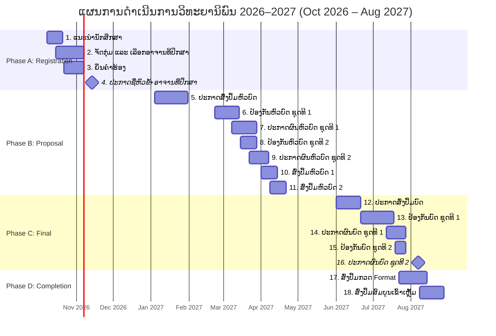

# Thesis Process Timeline — Academic Year 2026–2027

> **Source:** [Time Line.xlsx](file:///c:/Users/ASUS/OneDrive/เอกสาร/BTMS/Time%20Line.xlsx)  
> **Title:** ແຜນການດຳເນີນການ ຫົວຂໍ້ວິທະຍານິພົນ ແລະ ບົດວິທະຍານິພົນ ປີ 4 ລະດັບປະລິນຍາຕີ ສົກສຶກສາ 2026–2027  
> **Period:** October 2026 → August 2027 (weekly granularity, W1–W4 per month)  
> **Scope:** CEIT Department, Faculty of Engineering, National University of Laos (NUOL)

---

## The Official 18 Stages

| # | Step (ພາສາລາວ) | Step (English) | Planned Window | Period / Phase | BTMS Module & Features |
|:-:|---|---|---|---|---|
| 1 | ແນະນຳນັກສຶກສາ | Student Orientation | Oct 2026, W2–W3 | Registration | Cohort onboarding, Student guidelines |
| 2 | ຈັດກຸ່ມ ແລະ ເລືອກອາຈານທີ່ປຶກສາ | Group Formation & Advisor Selection | Oct 2026 W3–W4 – Nov 2026 W1 | Registration | Groups (2–3 students), Advisor Quota (84 cap, 21 advisors) |
| 3 | ຍື່ນຄຳຮ້ອງ | Submit Request Form | Oct 2026 W4 – Nov 2026 W1 | Registration | Thesis topic registration (5 categories, Multimedia cap 12) |
| 4 | ປະກາດຊື່ຫົວຂໍ້+ອາຈານທີ່ປຶກສາ | Announce Topics & Advisors | Nov 2026, W2 | Registration | Official roster print (`ປະກາດຊື່ຫົວຂໍ້+ອາຈານທີ່ປຶກສາ`) |
| 5 | ປະກາດສົ່ງປຶ້ມຫົວບົດວິທະຍານິພົນ | Announce Proposal Book Submission | Jan 2027, W1–W4 | Proposal Defense | Proposal document submission & fee intake |
| 6 | ປ້ອງກັນຫົວບົດວິທະຍານິພົນ ຊຸດທີ່ 1 | Proposal Defense Round 1 | Feb 2027 W4 – Mar 2027 W2 | Proposal Defense | Exam scheduling, Room & Committee allocation (Round 1) |
| 7 | ປະກາດຜົນຫົວບົດວິທະຍານິພົນ ຊຸດທີ່ 1 | Announce Proposal Results Round 1 | Mar 2027, W2–W4 | Proposal Defense | Committee PASS / FAIL decision entry & scoring |
| 8 | ປ້ອງກັນຫົວບົດວິທະຍານິພົນ ຊຸດທີ່ 2 | Proposal Defense Round 2 | Mar 2027, W3–W4 | Proposal Defense | Retake scheduling & retake fee handling (Round 2) |
| 9 | ປະກາດຜົນຫົວບົດວິທະຍານິພົນ ຊຸດທີ່ 2 | Announce Proposal Results Round 2 | Mar 2027 W4 – Apr 2027 W1 | Proposal Defense | Retake result finalization & progression |
| 10 | ສົ່ງປຶ້ມ ຫົວບົດວິທະຍານິພົນ 1 | Submit Proposal Book Round 1 | Apr 2027, W1–W2 | Proposal Defense | Proposal revision upload & advisor signoff |
| 11 | ສົ່ງປຶ້ມ ຫົວບົດວິທະຍານິພົນ 2 | Submit Proposal Book Round 2 | Apr 2027, W2–W3 | Proposal Defense | Retake proposal revision completion |
| 12 | ປະກາດສົ່ງປຶ້ມບົດວິທະຍານິພົນ | Announce Final Thesis Book Submission | Jun 2027, W1–W3 | Final Defense | Full thesis document submission & defense intake |
| 13 | ປ້ອງກັນບົດວິທະຍານິພົນ ຊຸດທີ່ 1 | Final Thesis Defense Round 1 | Jun 2027 W4 – Jul 2027 W3 | Final Defense | Final defense scheduling, Room & Committee allocation (Round 1) |
| 14 | ປະກາດຜົນວິທະຍານິພົນ ຊຸດທີ່ 1 | Announce Final Thesis Results Round 1 | Jul 2027, W3–W4 | Final Defense | Committee final PASS / FAIL grade certification |
| 15 | ປ້ອງກັນບົດວິທະຍານິພົນ ຊຸດທີ່ 2 | Final Thesis Defense Round 2 | Jul 2027, W4 | Final Defense | Retake defense scheduling & bonus calculation (Round 2) |
| 16 | ປະກາດຜົນວິທະຍານິພົນ ຊຸດທີ່ 2 | Announce Final Thesis Results Round 2 | Aug 2027, W1 | Final Defense | Retake grade finalization |
| 17 | ສົ່ງປຶ້ມ ບົດວິທະຍານິພົນ ກວດ Format | Submit Thesis Book for Format Check | Jul 2027 W4 – Aug 2027 W2 | Completion & Binding | Format validation & faculty compliance review |
| 18 | ສົ່ງປຶ້ມສົມບູນເພື່ອເຂົ້າເຫຼັ້ມ | Submit Final Complete Book for Binding | Aug 2027, W2–W4 | Completion & Binding | Printing queue, hard-cover binding & archive |

---

## 4 Main Phases (Department & Dean Reporting)

| Phase | Steps | Window | Key Milestones |
|---|:---:|---|---|
| **Phase A: Registration & Topic Assignment** | 1–4 | Oct – Nov 2026 | Grouping 2–3 students, advisor quota matching, official topic announcement |
| **Phase B: Proposal Defense (Rounds 1 & 2)** | 5–11 | Jan – Apr 2027 | Proposal book intake, Defense Rounds 1 & 2, committee scoring, revised book signoff |
| **Phase C: Final Defense (Rounds 1 & 2)** | 12–16 | Jun – Aug 2027 | Final book intake, Defense Rounds 1 & 2, committee evaluation, wage period calculation |
| **Phase D: Completion & Binding** | 17–18 | Jul – Aug 2027 | Format inspection, final hard-cover binding order, national thesis archiving |

---

## Visual Roadmap (Gantt Overview)

